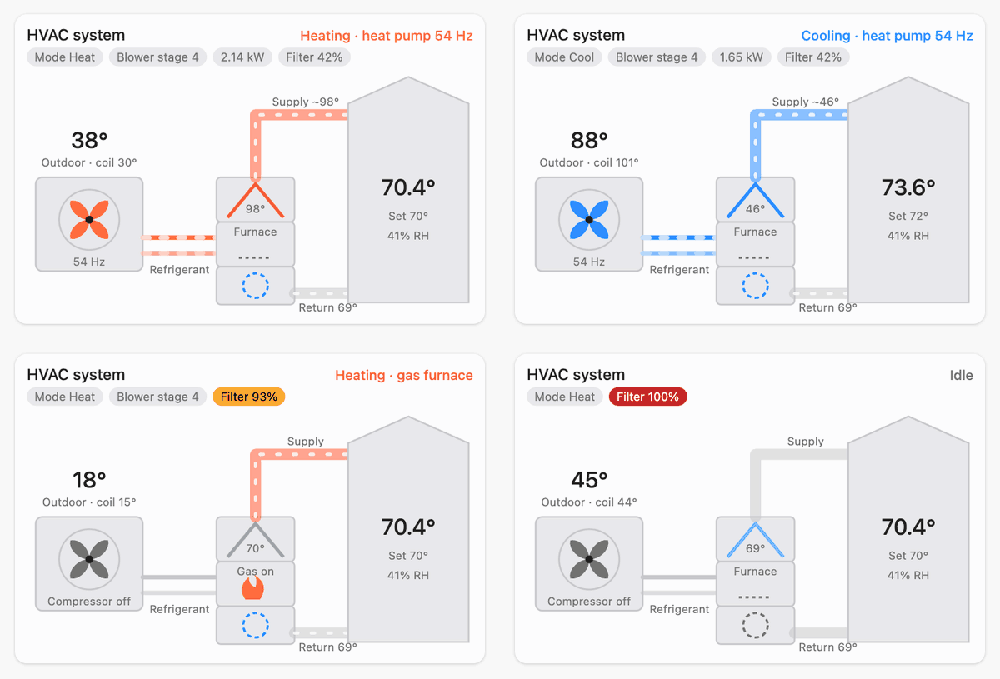
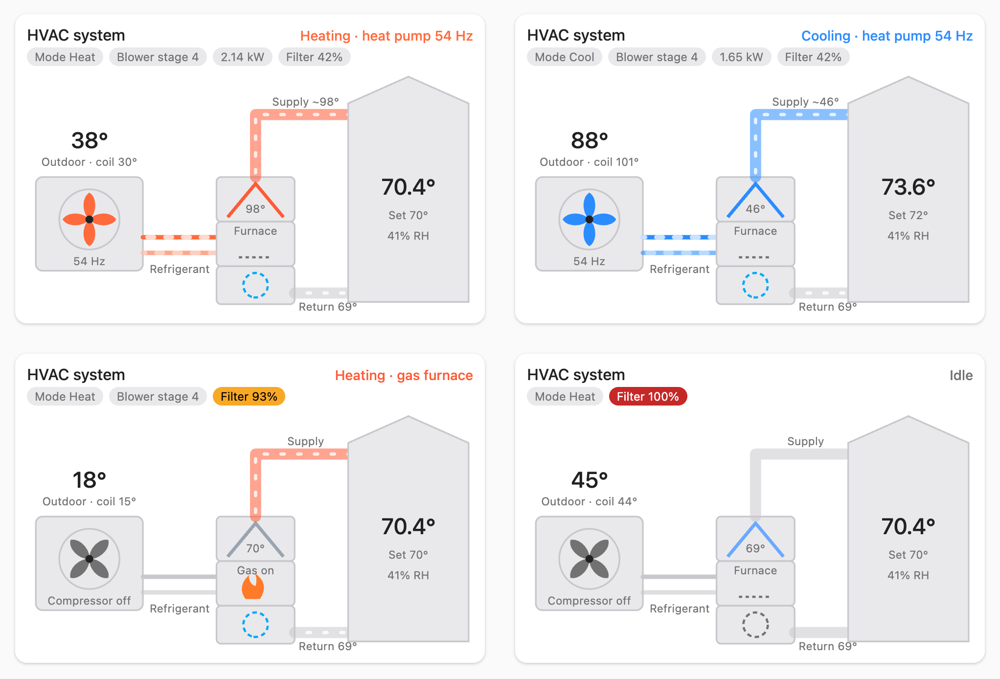
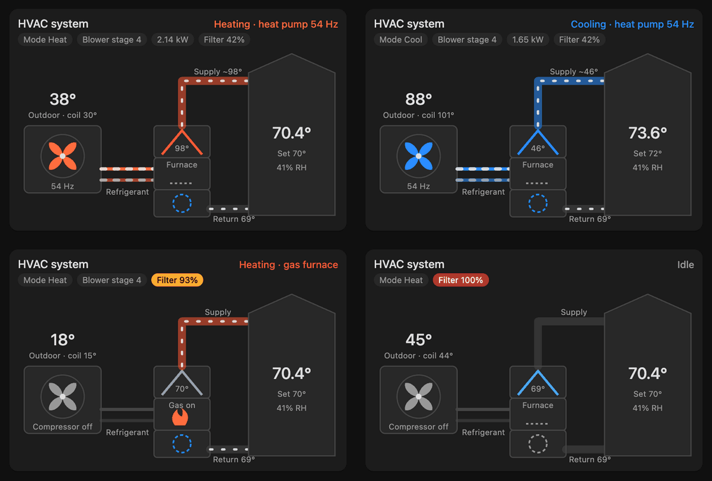
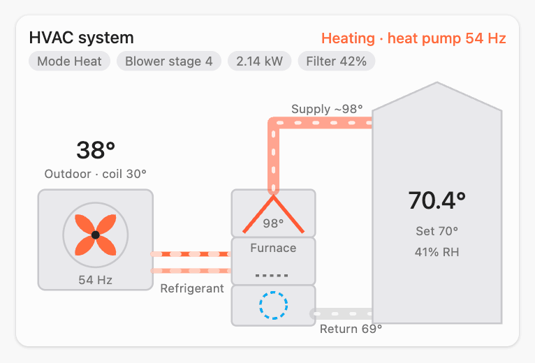
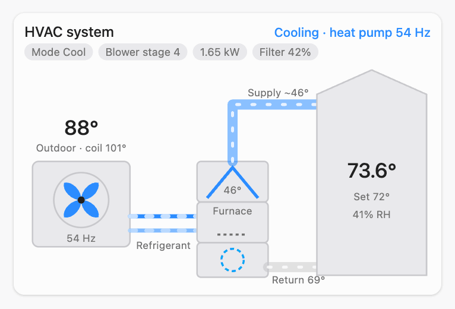
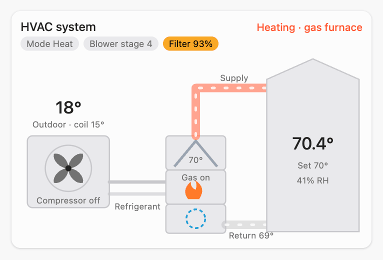
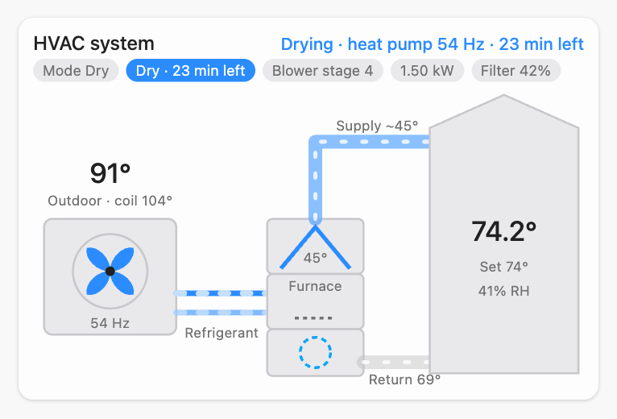

<p align="center">
  
</p>

<h1 align="center">ACiQ Thermostat (Local)</h1>

<p align="center">
  <a href="https://github.com/hacs/integration"></a>
  <a href="https://github.com/oxn0r/ha-aciq-thermostat/releases"></a>
  <a href="https://github.com/oxn0r/ha-aciq-thermostat/actions/workflows/validate.yml"></a>
  
  
  <a href="LICENSE"></a>
</p>

**Control your ACiQ thermostat from Home Assistant: locally, without the cloud.**

## In short
**The problem:** the ACiQ / Midea **TL04-1** Wi-Fi thermostat (also sold as "AC Pro") only works with
the ACiQ cloud app. It has no Home Assistant integration and no local API, and existing Midea integrations
(`midea_ac_lan`, msmart) don't support it.

**The solution:** the thermostat runs Linux with an open debug port (ADB). This integration uses that port
to put a tiny local API on the thermostat, then talks to it directly. No cloud, no account, no extra hardware.

**What you get in Home Assistant:**
- 🌡️ A normal thermostat card: Off / Auto / Heat / Cool / Fan / Dry, emergency heat, fan speed, setpoint
- 🔥 **Is the gas furnace burning? Is the heat pump running, and how hard?** (compressor Hz)
- 🌤️ **Outdoor temperature** from the outdoor unit, plus coil temperatures, blower state and fault codes
- Works with HomeKit, automations, dashboards, energy tracking

**Is this for me?** Yes, if your thermostat says **TL04-1** on the box or in the ACiQ app (also sold as Carrier
KSACN1701AAA and Midea-branded). It works wired to a Midea or ACiQ indoor unit (communicating HA/HB wiring, typical
for ACiQ heat pump, air handler and furnace systems) and with conventional 24 V wiring. Firmware builds and what each
supports: see [Supported devices](#supported-devices).

### Quick start (5 minutes)
1. Give the thermostat a fixed IP in your router (its hostname starts with `midea_`).
2. Open it in HACS, press **Download**, then restart Home Assistant:

   [](https://my.home-assistant.io/redirect/hacs_repository/?owner=oxn0r&repository=ha-aciq-thermostat&category=integration)
3. The thermostat usually appears under **Settings → Devices & services** as *Discovered*. If not, add it and enter
   its IP:

   [](https://my.home-assistant.io/redirect/config_flow_start/?domain=aciq_thermostat)
4. Review the safety checks it runs and press **Submit**. Done.

Setup stopped at *Pre-flight checks failed*, or something isn't right later? See
[Getting a debug report](#getting-a-debug-report-and-diagnostics): one file is all that's needed to help.

> Recommended: block the thermostat's internet access in your router afterwards. The debug port it relies on is open to your
> whole network, and blocking the internet also stops firmware updates that might close it. See [Security](#security).

Want the details? Everything below explains how it works, what's verified, and how to troubleshoot.

> **Credit:** this project exists because of [jeffmcfadden/midea-thermostat](https://github.com/jeffmcfadden/midea-thermostat).
> It discovered the TL04-1's open root ADB access, reverse-engineered the `dev_app` IPC/msmart message
> format, and wrote the original `thermostat_api` daemon this integration's daemon is derived from.

---

## Supported devices
| Device | Status |
|---|---|
| ACiQ / Midea **TL04-1**, Tina Linux build `tina.tangly.20260314.152301`, communicating (HA/HB) wiring to a Midea indoor unit | **Verified**: full control and equipment data |
| Same thermostat on build `tina.tangly.20260821.063106` (e.g. Midea-branded) | **Supported** since 1.1.1 ([#8](https://github.com/oxn0r/ha-aciq-thermostat/issues/8)): control, mode, setpoints, temperature, humidity; equipment data (outdoor unit, coils, compressor, blower, furnace, faults) since 1.1.3. Each command is checked against what the thermostat reports |
| Same thermostat on build `tina.tangly.20251105.024132` (e.g. AC Pro-branded) | **Testing** in 1.3.1b2 ([#12](https://github.com/oxn0r/ha-aciq-thermostat/issues/12)): read-only (mode, setpoint, temperature, humidity, equipment data); control stays off until this build's commands are compared |
| Same thermostat on another firmware build | New setups stop at pre-flight (open an issue with its output); a thermostat that updates itself after setup keeps readings, with control blocked (see [Safety](#safety)) |
| TL04-1 wired conventionally (24 V R/C/W/Y/G), e.g. Carrier KSACN1701AAA | **Supported** since 1.1.0 ([#5](https://github.com/oxn0r/ha-aciq-thermostat/issues/5)): mode (Off, Heat, Cool, Auto, Fan only, Emergency heat), setpoint, Auto low/high, room temperature and the 24 V outputs it drives. No fan speed (single fan output) and no equipment data. Tested on a heat pump with hydronic aux heat; other 24 V setups, please report |
| Other Midea / NetHome / Cooper & Hunter thermostats | Not supported |

Verified hardware: TL04-1 hardware V4.3, screen firmware LD:1.2.60, indoor unit firmware
`00AC000111171171000066111008`, with an ACiQ dual-fuel system (heat pump + gas furnace).

## How it works
The TL04-1 runs Linux and exposes an unauthenticated root **ADB** shell on TCP 5555. The integration:

1. **Pre-flight (read-only):** connects over ADB (pure Python, works on Home Assistant OS) and checks
   - the root shell
   - the firmware build and the `dev_app` binary hash
   - the IPC queues
   - the wiring (communicating HA/HB or conventional 24 V)
2. **Deploy:** copies a 65 KB daemon (`thermostat_api`, built reproducibly from [`daemon/`](daemon/)) to the
   thermostat's **RAM disk** (`/tmp`). It verifies the checksum, then starts it with an IP allowlist of Home Assistant only.
   **Nothing persistent on the thermostat changes.**
3. **Poll and control:** reads the daemon's local HTTP API every 30 s. Commands are the same msmart frames the ACiQ app sends
   through the cloud. Mode, fan and power frames are byte-for-byte captures from the app.
4. **Self-heal:** a thermostat reboot clears `/tmp`, so the integration redeploys automatically.

### Safety
- **Firmware guard:** control works only on the builds listed in [Supported devices](#supported-devices). On any other
  build, the daemon serves readings, rejects commands, and HA raises a **Repairs** issue.
- **All-or-nothing commands:** a request is fully validated before anything is sent.
- **Fan lock:** fan speed changes only in Heat or Cool, matching the thermostat's own UI.
- `dev_app`, `msmart`, `meiju` and the firmware are **never** modified, restarted or replaced.

## Installation
**Before you start:** give the thermostat a DHCP reservation, and make sure Home Assistant can reach it on
TCP **5555** (ADB) and **8080** (API).

### HACS (recommended)
[](https://my.home-assistant.io/redirect/hacs_repository/?owner=oxn0r&repository=ha-aciq-thermostat&category=integration)

1. Use the button, or in HACS: ⋮ → **Custom repositories** → `https://github.com/oxn0r/ha-aciq-thermostat`, category
   **Integration**.
2. Search for **ACiQ Thermostat (Local)** → **Download** → restart Home Assistant.
3. The thermostat is usually **discovered automatically** (DHCP hostname `midea_*`). Otherwise:
   **Settings → Devices & services → Add integration → ACiQ Thermostat (Local)**, or:

   [](https://my.home-assistant.io/redirect/config_flow_start/?domain=aciq_thermostat)

### Manual
Copy `custom_components/aciq_thermostat` into your `config/custom_components/`, then restart Home Assistant.

## Configuration
### Setup fields
| Field | Default | Description |
|---|---|---|
| IP address | (required) | Thermostat IP (hostname `midea_xx_xxxx` in your router) |
| Name | Thermostat | Device name, e.g. *Family Room* |
| API port | 8080 | Port the on-device daemon listens on |
| ADB port | 5555 | Thermostat's ADB port |

You'll then see the pre-flight results. Submitting deploys the daemon.

### Options (Settings → Devices & services → ACiQ Thermostat → Configure)
| Option | Default | Description |
|---|---|---|
| Automatically (re)deploy the daemon | on | Deploy at startup and after thermostat reboots |
| Keep the thermostat clock in sync with Home Assistant | on | Corrects drift ≥ 2 s after reboots and every 6 h (the thermostat can't use NTP with its internet blocked) |
| Block the thermostat's internet at the source | off | Runtime firewall rule on the thermostat: only LAN/HA traffic leaves it (see [Router flooded](#router-flooded-with-dns-lookups)) |
| Extra allowed IPs | (empty) | Other hosts allowed to use the API directly (HA's own IP is always allowed) |
| Hide fan speed on the thermostat | off | Removes fan speed from the thermostat entity (its card and Apple Home); the *Fan setting* sensor still shows it. Use this rather than overriding `supported_features` (see [Troubleshooting](#troubleshooting)) |
| After Dry, return to the previous mode | on | When Dry started from Home Assistant ends, put back the mode (and setpoint) it was started from; off = stay in Cool, like the screen (see [Dry](#dry-dehumidify)) |

**Reconfigure** (⋮ → Reconfigure) changes the IP or ports. It re-runs the checks and refuses if a different thermostat answers.

## Entities
| Entity | Type | Notes |
|---|---|---|
| *Thermostat* | climate | Off / Auto / Heat / Cool / Fan only / Dry (communicating systems) · preset **Emergency heat** · fan Auto/Low/Medium/High (Heat & Cool; option to hide) · 60–86 °F or 16–30 °C (follows the thermostat's unit) · Auto shows one setpoint or a heat/cool range, following the thermostat (see below) |
| Temperature · Humidity | sensor | thermostat's compensated sensor |
| **Outdoor temperature** | sensor | outdoor unit T4 |
| Indoor coil / Outdoor coil temperature | sensor | T2A / T3 |
| **Compressor frequency** | sensor (Hz) | inverter speed; 0 = off. Attributes: raw indoor-unit bits for mapping defrost ([#9](https://github.com/oxn0r/ha-aciq-thermostat/issues/9)) |
| Blower stage | sensor | 0 off, 1 low … 4 (high stages seen with the furnace) |
| Setpoint · Mode · Fan setting | sensor | |
| **Dry duration** | select | 15 / 30 / 45 / 60 min: the thermostat's own Dry duration, the same value the screen shows (communicating systems) |
| **Dry time left** | sensor (min) | the screen's Dry countdown; 0 when not drying. Attribute `ends_at` (communicating systems) |
| **Dehumidification** | switch | the screen's *Dehumidification* switch: cooling tuned to remove more moisture (not Dry). Turns on in Cool only, like the screen (greyed out while off outside Cool); off in any mode. Only on systems whose indoor unit has it ([#11](https://github.com/oxn0r/ha-aciq-thermostat/issues/11)) |
| **Furnace** | binary_sensor | **burner on**; verified against the furnace firing |
| Compressor · Blower | binary_sensor | running |
| Fault · Fault codes | binary_sensor / sensor | equipment fault or protection state |
| Power · Emergency heat | binary_sensor | |
| Redeploy daemon · Collect debug report | button | maintenance; *Collect debug report* runs pre-flight plus the build details below and adds them to the next diagnostics download (takes ~10 s; the page shows no pop-up) |
| Last debug report | diagnostic | when *Collect debug report* last finished; attributes: pre-flight result, failed checks, whether `dev_app` has debug info |
| Firmware · Indoor unit firmware · Last thermostat boot · Daemon started · Clock offset · Local control enabled · Aux heat allowed · Wi-Fi signal · Indoor unit T1 · Auto state | diagnostic | *Aux heat allowed* = backup (furnace) heat permitted in the current mode (on in Heat), not burning; the last three are disabled by default |
| Auto setpoint type · Auto heat setpoint · Auto cool setpoint · Deadband | diagnostic | *One setpoint* or *Heat/cool range*; the heat/cool setpoints are shown only while Auto holds a range |

### Auto: one setpoint or a heat/cool range
The thermostat's Auto either holds **one setpoint** (with its deadband) or a **heat/cool range**, depending on its own
setting. The integration follows it automatically, with nothing to configure: in Auto the card shows one target, or
low/high targets, and switches within a second or two if the setting changes. Heat and Cool always use one setpoint.
Range writes are checked: if the thermostat doesn't report the new range (it clamps values to its limits), you get an
error with the values it kept. Apple Home builds its controls when HomeKit Bridge starts, so **reload HomeKit Bridge**
after changing this setting on the thermostat.

**Don't override the thermostat's `supported_features`** (e.g. in `customize.yaml`). The integration changes them
with the mode: one setpoint, a heat/cool range in Auto, fan speed only in Heat and Cool. A fixed number leaves some
out, for example the Auto range, and the card then shows no setpoint handles. To keep fan speed out of Apple Home,
use the option **Hide fan speed on the thermostat** instead.

**Apple Home shows "Keep between" (two handles) while the thermostat holds one setpoint?** Apple Home is using an
outdated copy of the accessory, and both handles move the same single setpoint (the last one moved wins). Recreate it:
**Developer tools → Actions → HomeKit: Reset accessory** (`homekit.reset_accessory`) on the thermostat's climate
entity. Apple Home then shows **"Set to"** with one handle. The reset accessory may need to be put back in its room
and scenes.

The climate entity's **hvac_action** combines furnace, compressor and blower: *heating*, *cooling*, *drying*, *fan* (blower only), *idle* or *off*.

### Dry (dehumidify)
On communicating systems, the thermostat's **Dry Mode** runs the heat pump with a colder coil and a slower blower to
pull more moisture out of the air, for a set time. Home Assistant controls it like the screen does:
- **Start it:** pick **Dry** on the thermostat card (or `climate.set_hvac_mode: dry`), which runs for the current
  **Dry duration**; or use the **Start Dry** action with a duration.
- **Cool first:** the thermostat only starts Dry from Cool. From Heat, Auto, Fan only or Off, Home Assistant switches
  to Cool first and notes it in the logbook.
- **Countdown:** the screen counts down; **Dry time left** follows it. Changing **Dry duration** while Dry runs
  applies to the next Dry; the running countdown carries on. Dry also ends by itself when the room drops
  below 65 °F, or when the mode is changed. The setpoint can be changed while drying.
- **Afterwards:** the thermostat is in Cool. With *After Dry, return to the previous mode* on (the default), Home
  Assistant puts back the mode (and setpoint) Dry was started from, for Dry it started itself. Dry started on the
  screen is left alone.

## Actions, triggers and conditions
Use the standard `climate.*` actions (`set_temperature`, `set_hvac_mode`, `set_fan_mode`, `set_preset_mode`,
`turn_on`, `turn_off`), `switch.turn_on`/`turn_off` (Dehumidification, Block cloud traffic), `select.select_option` (Dry duration) and `button.press`. One custom action:

| Action | Fields | Does |
|---|---|---|
| `aciq_thermostat.start_dry` | target: the thermostat's climate entity; `duration` (optional): 15, 30, 45 or 60 | Starts Dry for that many minutes (the current Dry duration when left out), switching to Cool first if needed |

Triggers and conditions use the regular state, numeric-state and device triggers on the entities above.

## Data updates
**Push-style:** the integration long-polls the on-device daemon (`/api/state?wait=…`), which answers as soon as the
mode, setpoints, fan, auxiliary/emergency heat, Auto decision or equipment run state changes, so edits made on the wall
unit show up in ~1–2 s. Room temperature and humidity arrive with every answer (at least every 25 s). A 30 s watchdog
poll handles outages and older daemons. The daemon reads:
- the thermostat's own state log (mode, setpoint, room conditions), and
- the indoor/outdoor equipment state that `dev_app` keeps in memory. That state updates every few seconds from the HA/HB bus.

Equipment entities go **unavailable** if that data can't be read (for example, on an unverified firmware).

## System card

The integration includes the **ACiQ System Card**, an animated schematic of a ducted heat pump system with gas furnace backup: outdoor unit, refrigerant lines, indoor coil on the furnace, blower, ducts and the house.





<details><summary>Dark theme, and one state per image</summary>



| Heat pump heating | Cooling | Gas furnace | Dry |
|---|---|---|---|
|  |  |  |  |

</details>

- The outdoor fan spins while the compressor runs, faster at higher compressor frequency.
- Refrigerant lines turn red when heating and blue when cooling, with the flow reversing in cool.
- A flame shows when the gas furnace is on, and the blower spins while it runs.
- In Dry, the lines run blue as in cooling, water drips off the coil, and the header and a chip show the time left.
- The house shows room temperature, setpoint and humidity. Chips show mode, blower stage, fault, and optionally power and filter use.
- Tap any part to open that entity.

**No Lovelace resource is needed.** The integration serves the card and loads it in every dashboard. After an update, reload the browser once to get the new card. Add it from the dashboard's card picker (*ACiQ System Card*, with a visual editor), or in YAML:

```yaml
type: custom:aciq-system-card
title: HVAC system                  # optional
device_id: 0123456789abcdef         # optional: needed only with more than one ACiQ thermostat
entities:                           # optional overrides; null hides one
  power: sensor.heat_pump_power     # power chip (any power sensor)
  filter: sensor.furnace_filter_life_used   # filter chip, % used (warns at 90, red at 100)
```

The card finds the thermostat's entities through the device, so it works whatever the device or its entities are named. How each part is chosen, first match wins:
1. `entities:` override for that part
2. `device_id`
3. the only ACiQ thermostat, if there's exactly one

<details><summary>Override keys</summary>

`climate`, `room`, `humidity`, `setpoint`, `mode`, `outdoor`, `outdoor_coil`, `indoor_coil`, `return_air`, `hz`,
`blower_stage`, `compressor`, `furnace`, `blower`, `fault`, `fault_codes`, `dry_left`, `power`, `filter`.

</details>

The schematic shows what the equipment data reports, so it needs firmware with equipment data (see [Supported devices](#supported-devices)). Without it, the house and mode still show, and the equipment stays idle.

## Examples and use cases
<details><summary>Know which heat source is running (dual fuel)</summary>

```yaml
template:
  - sensor:
      - name: Heat source
        state: >
          Gas furnace
          Heat pump
          Idle
```

</details>

<details><summary>Notify on an equipment fault</summary>

```yaml
automation:
  - alias: HVAC fault
    triggers:
      - trigger: state
        entity_id: binary_sensor.family_room_fault
        to: "on"
    actions:
      - action: notify.notify
        data:
          message: "HVAC fault: {{ states('sensor.family_room_fault_codes') }}"
```

</details>

<details><summary>Dry out a muggy house while cooling</summary>

```yaml
automation:
  - alias: Dry when humid
    triggers:
      - trigger: numeric_state
        entity_id: sensor.family_room_humidity
        above: 60
        for: "00:10:00"
    conditions:
      - condition: state
        entity_id: climate.family_room
        state: cool
    actions:
      - action: aciq_thermostat.start_dry
        target:
          entity_id: climate.family_room
        data:
          duration: 30
```
After the 30 minutes the thermostat is back in Cool. Started from Heat or Auto instead, it returns to that mode
(option *After Dry, return to the previous mode*).

</details>

<details><summary>Night setback</summary>

```yaml
automation:
  - alias: Night setback
    triggers:
      - trigger: time
        at: "22:30:00"
    actions:
      - action: climate.set_temperature
        target:
          entity_id: climate.family_room
        data:
          temperature: 66
```

</details>

Other uses: chart compressor Hz against outdoor temperature to see how the heat pump modulates; count furnace
runtime (*history_stats*) to estimate gas use; alert when the outdoor coil stays near freezing (defrost behaviour).

## Known limitations
- Setpoints are whole degrees: 60–86 °F, or 16–30 °C when the thermostat is set to Celsius (both supported; the integration follows the thermostat's unit).
- **Auto heat/cool range** support is new in 1.1.0: verified from a user's logs, a write test on a single-setpoint
  TL04-1 and on a 24 V unit running Auto with a range; not yet confirmed on a communicating unit running a range.
- **24 V thermostats** are new in 1.1.0 and tested on one setup (heat pump with hydronic aux heat). A cooling run on
  real equipment hasn't been seen yet. `recent_log` in diagnostics covers only the thermostat's own log window
  (a few minutes): download diagnostics soon after the problem.
- In **Heat**, a setpoint far above room temperature makes the system go straight to the furnace (dual-fuel staging).
  That's the equipment's behaviour, not the integration's.
- Fan speed can't be changed in Auto, Fan-only or Dry (the thermostat locks it).
- **Dry** is new in 1.2.0, for communicating systems only (24 V thermostats don't offer it). Tested on the verified
  firmware; on other builds, please report how it behaves.
- Schedules, vacation mode and installer settings aren't exposed.
- The thermostat's adbd stalls when **two** ADB hosts connect at once. Keep other ADB tools disconnected.
- A firmware update could close ADB. Block the thermostat's internet access to prevent updates (see [Security](#security)).

### Outages
If the API stops answering, the integration checks why and logs one line, for example:
`Thermostat API on 10.0.0.65 unavailable: TimeoutError; TCP 8080 timeout, ADB 5555 timeout -> thermostat unreachable on the network (Wi-Fi drop or power loss)`.
*Network down:* waits for the thermostat to come back (re-checks every ≤10 s). *Daemon gone* (thermostat rebooted):
redeploys immediately. *Daemon hung:* forces a restart. Diagnostics show the last outages and deploys, and the
*Last thermostat boot* sensor makes reboots obvious. The TL04-1's Wi-Fi radio (XR819) occasionally faults and recovers
on its own within a few minutes; a stable 2.4 GHz access point helps.

### Router flooded with DNS lookups?
With the thermostat's internet blocked, the ACiQ cloud client (`msmart`) retries DNS endlessly (8.8.8.8, 1.1.1.1, …),
around 40 lookups per second. Turn on **Configure → Block the thermostat's internet at the source**: a temporary
firewall rule on the thermostat drops everything except your LAN and Home Assistant, so the traffic never reaches your
router. It's re-applied after reboots and removed when you turn it off. There's also a **Block cloud traffic** switch on
the device page for one-tap on/off.

<details><summary>What's blocked, and the measured effect</summary>

Only public internet destinations are dropped (NTP on UDP 123 is let through so a router-side NTP intercept can answer). Local traffic is never filtered: your LAN, every private range
(10/8, 172.16/12, 192.168/16), link-local, 100.64/10 (VPNs such as Tailscale), Home Assistant, broadcast and multicast.
The rule lives in the thermostat's memory only, so a power cycle always clears it. The integration verifies it after
every reboot and every 30 minutes.

Measured on a TL04-1: the cloud client's CPU use dropped from ~23 % to ~2 % of a core, its DNS traffic from ~40
packets/s to zero, and system load fell noticeably.

</details>

## Troubleshooting
| Symptom | Fix |
|---|---|
| Setup says *Could not reach the thermostat over ADB* | Check IP and port 5555 reachability from HA; disconnect any other `adb` session; power-cycle the thermostat if adbd is stuck |
| *Pre-flight checks failed* | Firmware or device differs from the supported builds. Nothing was changed on the thermostat, and a debug report was saved: see [Setup failed at pre-flight](#setup-failed-at-pre-flight-get-the-saved-report) |
| Reporting a problem | Right after it happens, follow [Getting a debug report](#getting-a-debug-report-and-diagnostics) and attach the file to a [bug report](https://github.com/oxn0r/ha-aciq-thermostat/issues/new?template=bug_report.yml). No ADB capture is needed |
| Entities unavailable after a thermostat reboot | Wait ~1 minute (auto-redeploy) or press **Redeploy daemon** |
| Repairs: *firmware changed — local control disabled* | The thermostat updated itself. Readings continue. Follow [Getting a debug report](#getting-a-debug-report-and-diagnostics) and [open a new-firmware issue](https://github.com/oxn0r/ha-aciq-thermostat/issues/new?template=new_firmware.yml) |
| No setpoint handles on the thermostat card (e.g. in Auto) | Remove any `supported_features` override for the climate entity (customize); to hide fan speed, use the option *Hide fan speed on the thermostat* ([#7](https://github.com/oxn0r/ha-aciq-thermostat/issues/7)) |
| Apple Home shows a range (*Keep between*) in Auto | See [Auto: one setpoint or a heat/cool range](#auto-one-setpoint-or-a-heatcool-range) |
| Commands ignored / 400 errors | See the HA log; the daemon reports why (validation, fan lock, firmware guard) |

### Getting a debug report and diagnostics
One file is enough for a bug report or a new firmware, with no ADB commands. It's read-only and leaves out IP
addresses and the serial number. Do this **soon after** the problem: the thermostat's own log only keeps a few minutes.
A computer's browser is easiest, since the download is a file you attach on GitHub.

**If the thermostat is set up:**
1. Open **Settings → Devices & services → ACiQ Thermostat (Local)**, then click your thermostat's device (e.g.
   *Family Room*) to open its device page.
2. In the **Diagnostic** card, press **Collect debug report**. Home Assistant shows no pop-up for a button. Wait
   about 10 seconds, until **Last debug report** in the same card shows the current time. A notification also
   appears under the **bell** in the sidebar.
3. On the same device page, open the **⋮** menu (top right) → **Download diagnostics**. Your browser saves a file
   named like `config_entry-aciq_thermostat-<id>.json` (usually in *Downloads*). It includes the debug report.
4. Open a [bug report](https://github.com/oxn0r/ha-aciq-thermostat/issues/new?template=bug_report.yml) for a problem, or a
   [new-firmware issue](https://github.com/oxn0r/ha-aciq-thermostat/issues/new?template=new_firmware.yml) for an unsupported build.
   Drag the file into the issue, and say what you did and when.

Skipping step 2 still gives a useful file (state, versions, deploy and command log, recent thermostat log lines).
The debug report adds the build details needed for a new firmware.

#### Setup failed at pre-flight: get the saved report
Nothing was changed on the thermostat. The error message names a file the integration saved in your Home Assistant
configuration folder, like `aciq_thermostat_debug_report_20261029_183000.json`. To get it onto your computer:
- **Home Assistant OS / Supervised:** with the **Studio Code Server** app (add-on), right-click the file at the top of
  the `config` folder → **Download**. Or open the `config` share from your computer with the **Samba share** app.
- **Home Assistant Container (Docker, e.g. Synology):** it's in the host folder you mapped to `/config`. On a
  Synology, open it in **File Station** and download it.
- **Core:** it's in your configuration directory (usually `~/.homeassistant`).

Then [open a new-firmware issue](https://github.com/oxn0r/ha-aciq-thermostat/issues/new?template=new_firmware.yml)
and drag the file in.

<details><summary>What's in the debug report</summary>

The debug report contains the firmware and binary hashes, kernel and memory, the thermostat processes, the log window
and which functions log how often, whether Home Assistant is behind NAT (Docker), and, from a copy of `dev_app` parsed
in Home Assistant, its symbols, the layout of its state block (`g_self_state`) and a dump of that block with the
serial zeroed. That's what's needed to map equipment data and new features (like defrost) on a new build. The
`dev_app` binary itself isn't included.

</details>

**Debug log** (only if asked): **Settings → Devices & services → ACiQ Thermostat (Local) → ⋮ → Enable debug
logging**, reproduce the problem, then **⋮ → Disable debug logging**. Home Assistant then downloads the log file;
attach it alongside the diagnostics. Or set it permanently in `configuration.yaml`:
```yaml
logger:
  logs:
    custom_components.aciq_thermostat: debug
```

## Security
ADB on 5555 is a **root shell with no password** for anyone who can reach it. That's a device property, not something this integration adds. Recommended:
- Block the thermostat's internet access (this also stops OTA updates). Optionally allow NTP (UDP 123).
- Allow only Home Assistant → thermostat TCP 5555 and 8080. Same-subnet traffic often bypasses router firewalls,
  so test from another device that `nc -z <thermostat-ip> 5555` **fails**, or put IoT devices on their own VLAN.
- The API daemon accepts only allowlisted client IPs.

## Removal
1. **Settings → Devices & services → ACiQ Thermostat (Local) → ⋮ → Delete.** This also stops the daemon on the thermostat.
   It lived in RAM only, so nothing remains after the next thermostat reboot either.
2. Remove the repository from HACS (HACS → the integration → ⋮ → Remove) and restart Home Assistant.

## Quality
This custom integration follows every rule of Home Assistant's
[Integration Quality Scale](https://developers.home-assistant.io/docs/core/integration-quality-scale/) through
**Platinum**. The status of each rule is in [`quality_scale.yaml`](custom_components/aciq_thermostat/quality_scale.yaml).
Official tiers are awarded only to core integrations. Highlights:
- config flow with DHCP discovery, reconfigure and options
- runtime data and unique IDs, diagnostics, Repairs issues
- entity, exception and icon translations
- `mypy --strict`, async dependencies and an injected web session
- **>95 % test coverage**, with a simulated thermostat for the ADB layer, plus an optional live end-to-end test

## Development
```sh
pip install pytest-homeassistant-custom-component "adb-shell[async]>=0.4.4" mypy pytest-cov
pytest --ignore=tests/live --cov                 # unit tests (>95 % coverage required)
mypy                                             # strict typing
node --test tests/frontend/card.test.mjs         # system card logic
ACIQ_LIVE_HOST=<ip> pytest tests/live -s         # end-to-end against a real thermostat
daemon/build.sh                                  # rebuild the daemon (official zig 0.17.0, Linux x86_64 = canonical)
```

Card images in `docs/images/` are generated from the card's own code: see [tools/card_media](tools/card_media/README.md).

## Credits and license
- **[jeffmcfadden/midea-thermostat](https://github.com/jeffmcfadden/midea-thermostat)**: ADB access, IPC protocol, temperature
  frame, original daemon and HA component.
- This project added communicating-system (HBS/AHU3) support, mode/fan/off frames captured from the ACiQ app, the equipment
  data (outdoor temperature, coils, compressor, furnace, blower, faults), the safety guards, and the self-deploying HACS integration.
- Not affiliated with ACiQ, Midea or Home Assistant. "ACiQ" is used only to identify compatible hardware.

Licensed under the [MIT License](LICENSE). Portions are derived from jeffmcfadden/midea-thermostat, which is public domain (Unlicense).
