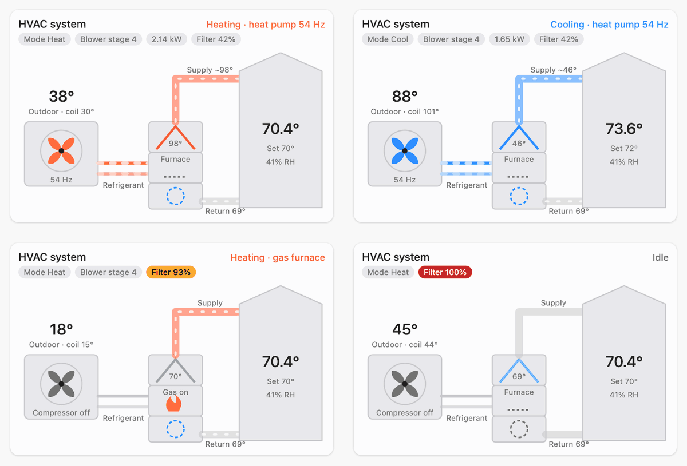
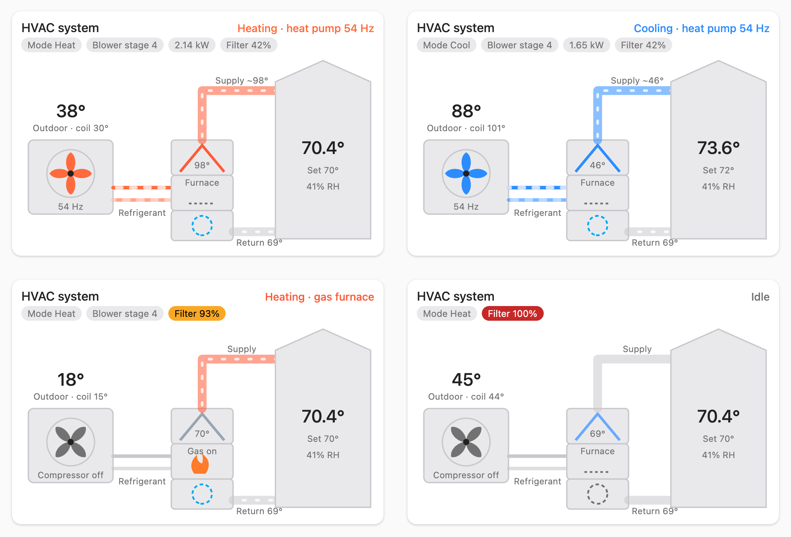
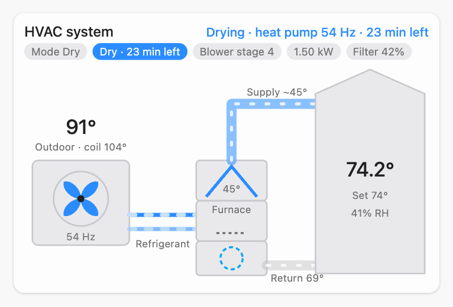

## New: ACiQ System Card

The integration now includes an animated card for your HVAC system: outdoor heat pump, refrigerant lines, indoor coil on the gas furnace, blower, ducts and the house, all driven by the thermostat's live data.

- The outdoor fan spins faster with compressor frequency. Refrigerant flows red when heating and blue when cooling. A flame shows when the furnace is on, and the blower turns with its stage.
- Chips for mode, blower stage, faults, and optionally power and filter use.
- **Nothing to install:** the integration loads the card in every dashboard. Add *ACiQ System Card* from the card picker; it finds your thermostat by itself, and has a visual editor.
- Works in light and dark themes.

The card shows equipment data, so it's most useful on firmware with equipment data (see Supported devices in the README).

## New: Dry (dehumidify)

On communicating systems, Home Assistant can now run the thermostat's **Dry Mode**: the heat pump runs a colder coil with a slower blower to pull more moisture out of the air, for 15, 30, 45 or 60 minutes.

- **Dry** is a mode on the thermostat card. **Dry duration** (a select) is the thermostat's own setting, the same value its screen shows, and **Dry time left** follows the screen's countdown.
- For automations, **`aciq_thermostat.start_dry`** starts Dry with a duration in one step.
- Like the screen, Dry starts from Cool. From Heat, Auto, Fan only or Off, Home Assistant switches to Cool first and notes it in the logbook.
- When Dry ends (countdown done, the room below 65 °F, or cancelled), the thermostat is in Cool. With the new option **After Dry, return to the previous mode** (on by default), Home Assistant puts back the mode and setpoint Dry was started from.
- The system card shows Dry with water dripping off the coil and the time left.

Thanks to [#10](https://github.com/oxn0r/ha-aciq-thermostat/issues/10) for the request. 24 V thermostats don't offer Dry.

## Fixed

- **Smoother card animation:** the card no longer restarts its animations on every sensor update, and every loop ends where it starts.
